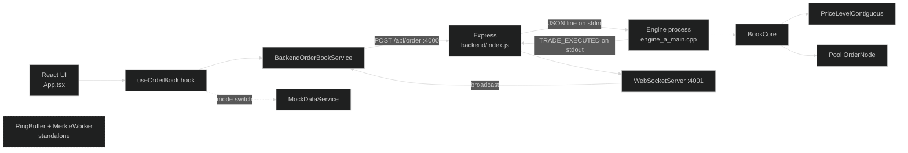
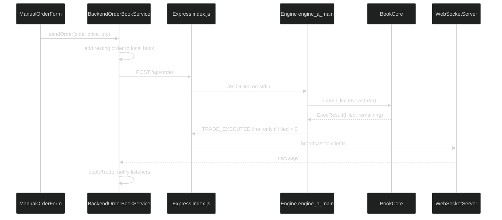

# order-book

A simulated limit order book that matches buy and sell orders in real time.


## Why it exists

A university minor project: a C++ price-time-priority matching engine, wired
through a Node.js bridge to a React dashboard. The UI shows the order book,
accepts limit orders and streams executed trades.

## Quick Start

Windows with MinGW is the tested path (the backend launches `backend/order_book.exe`).
Use three terminals, all opened in the repo root.

**1. Build the engine** (output lands in `backend/`):

```powershell
cmake -S . -B build -G "MinGW Makefiles"
cmake --build build --target order_book_engine
```

**2. Run the backend** (HTTP `:4000`, WebSocket `:4001`):

```powershell
cd backend
npm install
node index.js
```

Expected output: `Server running on port http://localhost:4000`. The line
`[C++ Error]: [engine] ready` is normal. The backend labels all engine stderr that way.

**3. Run the frontend** (Vite prints the URL, usually `http://localhost:5173`):

```powershell
cd frontend
npm install
npm run dev
```

**4. Verify:** submit a Sell, then a Buy at the same price. A trade appears in
Recent Trades and the backend terminal prints `TRADE_EXECUTED`. A lone order
prints nothing, because the engine only prints when an order fills.

**Tests and benchmarks:**

```powershell
cmake -S tests_and_benchmarks -B build-tests -G "MinGW Makefiles"
cmake --build build-tests --target ob_tests ob_bench ob_latency
.\build-tests\ob_tests.exe
```

The legacy suite also runs via `cmake --build build --target order_book`.
Frontend: `npm run lint` and `npm run build`. The backend has no test script.

## Architecture overview



The UI talks to a service behind the `IOrderBookService` interface. The default
is the backend service, and the mock simulator is a UI toggle. Express forwards
each order to the engine's stdin. The engine prints `TRADE_EXECUTED: {...}`
lines, and Express broadcasts them to all WebSocket clients.



The engine emits trades only. The frontend keeps its own local depth ladder: it
adds orders optimistically and subtracts fills on trade events. The reported
trade price is the best opposite price before matching.

`ring_buffer.hpp`, `merkle.hpp` and `merklebench.cpp` form a separate SPSC ring
buffer and Merkle-root worker. They are not wired into the engine or CMake.

## Configuration

All values are hard-coded constants; there are no environment variables.

| Name | Where | Default | Meaning |
|---|---|---|---|
| `PORT` | `backend/index.js` | `4000` | HTTP API |
| `WS_PORT` | `backend/index.js` | `4001` | WebSocket feed |
| `binaryPath` | `backend/index.js` | `backend/order_book.exe` | Engine executable |
| `TICKS_PER_RUPEE` | `Core/engine_a_main.cpp` | `2` | Tick size Rs 0.50 |
| `PriceBand` | `Core/engine_a_main.cpp` | `{0, 100000, 1}` | Valid ticks (Rs 0 to 50000) |
| Pool capacity | `Core/order_book_core.cpp` | `100000` | Max resting orders |
| `httpUrl` / `wsUrl` | `BackendOrderBookService.ts` | `localhost:4000` / `:4001` | Frontend endpoints |
| `OB_SANITIZE`, `OB_NATIVE`, `OB_USE_EXTERNAL_LIBS` | `tests_and_benchmarks/CMakeLists.txt` | `OFF` | Build options |

## Usage

**Send an order over HTTP** (PowerShell):

```powershell
Invoke-RestMethod -Method Post -Uri http://localhost:4000/api/order -ContentType "application/json" -Body '{"order":{"side":"sell","price":100,"quantity":5}}'
Invoke-RestMethod -Method Post -Uri http://localhost:4000/api/order -ContentType "application/json" -Body '{"order":{"side":"buy","price":100,"quantity":5}}'
```

The second call triggers `TRADE_EXECUTED` in the backend terminal.

**Drive the engine directly** (prints `TRADE_EXECUTED: {"side":"buy","price":100.00,"quantity":5}`):

```powershell
'{"side":"sell","price":100,"quantity":5}','{"side":"buy","price":100,"quantity":5}' | .\backend\order_book.exe
```

**Filter tests or include the known-bug tests:**

```powershell
.\build-tests\ob_tests.exe --filter=Pool
.\build-tests\ob_tests.exe --known-bugs
```

**Profile tail latency:**

```powershell
.\build-tests\ob_latency.exe --impl=contiguous --ops=500000 --json=latency.json
```

**Mock mode:** use "Mock Simulator" in the Engine Controls panel to run the UI without the backend.

## Project structure

```
Core/                  matching engine (types, mempool, order, order_book_core, engine_a_main)
Tests/                 legacy TestSuite
backend/               Express + ws bridge, engine binary output
frontend/              React + TypeScript + Tailwind dashboard
tests_and_benchmarks/  tests, benchmarks, latency tool, results, summarize.py
ring_buffer.hpp, merkle.hpp, merklebench.cpp   standalone Merkle pipeline
```

## Known limitations

- Windows only: the backend hardcodes `order_book.exe`.
- The engine has no cancel or market-order path (`BookCore::cancel` exists but is never called), and the UI's `type` field is ignored.
- Restarting the backend restarts the engine and clears its book, while the UI ladder is not reset.
- The initial order book ladder and the first 16 trades in the UI are generated client-side
  (`seedInitialTrades`, `initializeOrderBook` in `BackendOrderBookService.ts`). They are not
  engine data. Only orders you submit reach the C++ engine, and only its fills are real trades.

## Contributing and License

No license file or contribution guide is present in the repository.