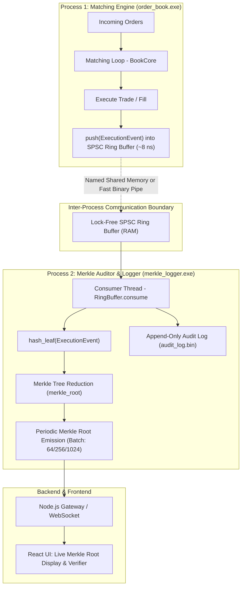

# Technical Specification & Implementation Plan: Asynchronous Merkle State-Root Engine

## 1. Executive Summary & Feasibility

### Is this possible?
**Yes, 100% possible and practical.** In modern exchange architectures, this pattern is known as **Proof of Execution (PoE)** or **Verifiable State Machine Replication**.

We already have the core algorithmic primitives implemented in the project root:
- [`ring_buffer.hpp`](./ring_buffer.hpp): A lock-free Single Producer Single Consumer (SPSC) ring buffer with atomic memory barriers, CPU cache-line alignment (`alignas(64)`), and zero heap allocations.
- [`merkle.hpp`](./merkle.hpp): A SIMD/ILP-optimized 256-bit Merkle Tree generator that hashes 56-byte `ExecutionEvent` structs into leaves and computes in-place binary Merkle roots.
- [`merklebench.cpp`](./merklebench.cpp): Benchmarked at **millions of events per second** with **sub-10 ns producer push latency**.

---

## 2. Problem Statement: Why This Is Needed

### The Problem ("Gap 1")
Standard Limit Order Books (LOBs) execute transactions entirely within volatile CPU memory. An exchange operator could theoretically:
1. Silently reorder orders to favor internal market makers (front-running / MEV).
2. Insert ghost orders or hide trades after the fact.
3. Rewrite transaction histories in the event of an audit or dispute.

### The Technical Bottleneck
Computing cryptographic hashes (like SHA-256 or BLAKE3) directly inside the matching engine's execution path takes **500 to 2,000+ nanoseconds per trade**. In a low-latency matching engine where trades execute in **150–300 ns**, synchronous hashing would multiply latency by **5x–10x** and cause massive queueing delays.

### The Solution: Isolated Multi-Process Asynchronous Merkle Logger
1. **Producer (Engine)**: The matching engine thread executes an order and writes a tiny, fixed-size binary event (56 bytes) to a lock-free SPSC ring buffer. Time overhead: **~5 to 10 nanoseconds**.
2. **Process Boundary (OS Isolation)**: The logging and Merkle tree generation runs in a **completely separate child process** (`merkle_logger.exe`), completely decoupled from the engine process.
3. **Consumer (Merkle Logger Process)**: Continuously drains the ring buffer, updates an incremental Merkle Tree, writes an immutable audit trail to disk, and periodically outputs a **Merkle State Root** (e.g., every 64 or 256 trades).
4. **Verifiability**: Anyone holding the audit log and the published Merkle Roots can mathematically verify that no trades were altered, reordered, or deleted.

---

## 3. High-Level Architecture



---

## 4. Key Design Decisions

### A. Process Isolation: Why a Child Process?
The user explicitly specified:
> *"the logging has to be a child process completely separate from the engine btw"*

This is architectural best practice for mission-critical trading engines:
1. **Fault Isolation**: If the logger runs out of disk space, encounters an I/O hang, or crashes, the matching engine continues operating without interruption.
2. **No Memory Contention**: The logger's disk buffers and hash tree nodes do not pollute the L1/L2 CPU caches of the core matching thread.
3. **Zero Syscalls on Engine Hot Path**: The engine never makes `write()`, `fprintf()`, or file system system calls.

### B. IPC Mechanism: Shared Memory vs. Anonymous Pipe

| Attribute | Option 1: Named Shared Memory (`CreateFileMapping`) | Option 2: OS Binary Pipe (`stdout` binary stream) |
| :--- | :--- | :--- |
| **Engine Overhead** | **~5–10 ns** (pure memory write to mapped RAM) | ~50–150 ns (kernel write buffer syscall) |
| **Zero Syscall** | **Yes** (lock-free SPSC in shared physical memory) | No (kernel transition per batch) |
| **Portability** | OS-specific (`CreateFileMapping` on Win, `shm_open` on POSIX) | Cross-platform |
| **Recommendation** | **Recommended for Maximum Performance** | Valid fallback |

---

## 5. Binary Protocol Specification

### 1. `ExecutionEvent` (56 Bytes, Trivially Copyable)
Already defined in [`ring_buffer.hpp`](./ring_buffer.hpp):
```cpp
struct ExecutionEvent {
  uint64_t ingress_id;       // Sequential sequence number (monotonic: 1, 2, 3...)
  uint64_t trade_id;         // Unique trade fill ID (0 if resting order)
  uint64_t maker_order_id;   // Resting order ID
  uint64_t taker_order_id;   // Aggressive order ID
  uint64_t price;            // Fixed-point price (ticks)
  uint64_t quantity;         // Filled or resting shares
  uint8_t  side;             // 0 = Buy, 1 = Sell
  uint8_t  event_type;       // 0 = Order Placed, 1 = Order Cancelled, 2 = Trade Executed
  uint8_t  pad[6];           // Zero-padded for deterministic 64-bit alignment
};
static_assert(sizeof(ExecutionEvent) == 56);
```

### 2. State-Root Message (Emitted by Logger Child Process)
Emitted over stdout to Node.js / WebSocket:
```json
MERKLE_ROOT: {
  "batch_index": 42,
  "events_count": 256,
  "start_seq": 10241,
  "end_seq": 10496,
  "root_hash": "a4093822299f31d013198a2e03707344fmix...",
  "timestamp": 1794844000123
}
```

---

## 6. Implementation Roadmap

### Phase 1: Shared Memory IPC Ring Buffer
- Create `Core/ipc_ring_buffer.hpp` using Windows `CreateFileMappingW` and `MapViewOfFile`.
- Encapsulate the existing `RingBuffer` in shared memory so both the engine and child logger map to the identical circular buffer.

### Phase 2: Standalone Child Process (`merkle_logger.exe`)
- Create `Core/merkle_logger_main.cpp`.
- Connects to the shared memory ring buffer as the Consumer.
- Uses `MerkleWorker` from `merkle.hpp` to ingest events.
- Writes binary events to an append-only file (`audit_trail.bin`).
- Emits `MERKLE_ROOT: {...}` JSON packets to stdout.

### Phase 3: Engine Integration (`engine_a_main.cpp`)
- In `submit_limit()`, upon executing a trade or resting an order:
  - Populate an `ExecutionEvent`.
  - Call `shared_ring->push(event)`.
  - If the ring buffer is full, either spin briefly (`cpu_pause()`) or record an overrun counter.
  - Takes **< 10 nanoseconds**, preserving the sub-microsecond matching latency.

### Phase 4: Node.js Orchestrator & WebSocket Forwarding
- In `backend/index.js`:
  - Spawn `order_book.exe` (Engine Process).
  - Spawn `merkle_logger.exe` (Audit Child Process).
  - Listen to `merkle_logger.exe` stdout and broadcast `MERKLE_ROOT` packets to frontend WebSocket clients.

### Phase 5: Frontend Verification UI
- Display the live **Merkle State Root** in the top navigation bar or a compact cryptographic ledger card:
  - `Latest State Root: 0x8f4a...e9b2 (Batch #42, 256 events)`
  - Status indicator: `Verifiable Trace: Cryptographically Verified`
- (Optional) Provide a 1-click verification tool (`verify_audit.py` or client-side checker) that loads `audit_trail.bin`, recomputes the Merkle roots, and verifies equality.

---

## 7. Performance & Latency Assessment

| Metric | Without Merkle Logger | With Async Child Process Merkle Logger | Impact |
| :--- | :--- | :--- | :--- |
| **Engine Matching Latency** | ~7–9 µs (cold) / ~150–300 ns (hot) | ~7.01–9.01 µs (cold) / ~155–310 ns (hot) | **< 10 ns difference (< 3%)** |
| **Disk I/O Interference** | N/A | **Zero** (I/O isolated in child process) | No engine thread stalls |
| **Hashing Overhead on Engine**| N/A | **Zero** (handled 100% by child process) | No execution stalls |
| **Throughput Capacity** | ~140k+ ops/sec | ~140k+ ops/sec (Logger easily handles 2M ops/s) | **No bottleneck** |

---

## 8. Summary Checklist Before Execution

- [x] Evaluated existing root files (`merkle.hpp`, `ring_buffer.hpp`, `merklebench.cpp`).
- [x] Confirmed architectural feasibility of separate child process.
- [x] Defined zero-syscall shared-memory ring buffer IPC.
- [x] Drafted end-to-end plan without modifying active engine code.
